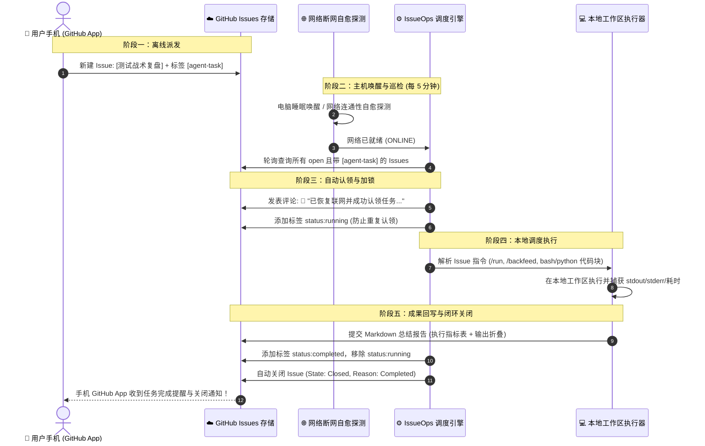

# 🛰️ GitHub IssueOps Agent (异步任务调度层)

> **不依赖实时在线、零公网 IP、零内网穿透的云端异步任务协同方案。**  
> 当你在外使用手机、家中电脑处于睡眠或网络临时中断时，只需在 GitHub App 提一个带有 `[agent-task]` 标签的 Issue；家中电脑重新联网后，后台引擎自动自愈检测、认领任务、在本地执行，并将结构化结果评论回写、自动关闭 Issue。

---

## 🎯 为什么设计 IssueOps？

| 传统远程调度方案 | 痛点 / 阻碍 | 🛰️ GitHub IssueOps 方案 |
| :--- | :--- | :--- |
| **SSH / 端口映射** | 需要公网 IPv4 / 复杂内网穿透 / 易受扫描攻击 | **零端口开放**：纯粹拉取（Pull）模式，绝对安全 |
| **手机实时在线连接** | 电脑一旦睡眠、关机或 Wi-Fi 断开即失联 | **天然异步信箱**：GitHub Issue 作为持久化分布式任务队列表 |
| **三方消息 Bot (如飞书/钉钉)** | 消息流杂乱，缺乏原生任务状态机与富文本工单闭环 | **工单即证据**：Issue 自带状态机（Open / Running / Completed / Closed）与清晰历史追溯 |

---

## 🔄 核心状态流转机制



---

## 📱 手机端使用指南 (GitHub App 提单模板)

在手机上打开 GitHub App，进入绑定的仓库（如 `FlameFlowAI/my-agent-memory`），点击 `New Issue`：

### 场景 1：执行周复盘反向沉淀到外脑
* **Title**: `第 01 周战术复盘反向沉淀`
* **Labels**: `[agent-task]` 或 `agent-task`
* **Body**:
  ```markdown
  在外通过手机触发周复盘数据沉淀至本地长期记忆：
  /backfeed
  ```

### 场景 2：执行任意工作区脚本或命令
* **Title**: `同步认知上下文与诊断双系统状态`
* **Labels**: `[agent-task]`
* **Body**:
  ```markdown
  /run /data/workspace/command_center_ctl.sh status
  ```
  或者直接使用标准代码块：
  ````markdown
  ```bash
  python3 /data/workspace/my-agent-memory/scripts/sync_to_dashboard.py
  ```
  ````

### 场景 3：执行临时 Python 认知计算任务
* **Title**: `计算乒乓球接发球弧线马格努斯偏转角`
* **Labels**: `[agent-task]`
* **Body**:
  ````markdown
  ```python
  import math
  rpm = 6000
  speed_kmh = 80
  print(f"偏转效应系数: {rpm * 0.0012 / speed_kmh:.4f}")
  ```
  ````

---

## 🚀 家用电脑端部署与使用

### 1. 配置文件初始化
复制模版文件生成 `config.json`：
```bash
cp config.example.json config.json
```
在 `config.json` 中填入你的 GitHub Personal Access Token (PAT with `repo` scope)：
```json
{
  "github_token": "ghp_xxxxxxxxxxxxxxxxxxxx",
  "repo": "FlameFlowAI/my-agent-memory",
  "target_labels": ["agent-task", "[agent-task]"],
  "poll_interval_seconds": 300,
  "workspace_root": "/data/workspace"
}
```

### 2. 控制脚本命令速查 (`issueops_ctl.sh`)

```bash
# 1. 运行自检与 Mock 全流程端到端测试 (无需 Token 即可体验完整闭环)
./issueops_ctl.sh test

# 2. 查看当前状态、网络连通性与已闭环任务数
./issueops_ctl.sh status

# 3. 手动单次触发巡检 (测试真实 GitHub 仓库)
./issueops_ctl.sh run-once

# 4. 启动后台定时轮询守护进程 (默认每 5 分钟自动检测一次)
./issueops_ctl.sh start

# 5. 查看实时运行日志
./issueops_ctl.sh logs

# 6. 停止守护进程
./issueops_ctl.sh stop
```

---

## ⏰ 推荐生产部署：Linux Crontab 定时唤醒

如果你希望即使关闭终端，家用电脑在每次开机或唤醒后都能自动巡检，最简单可靠的方式是配置系统 Cron：

运行 `./issueops_ctl.sh cron` 查看建议，或直接在终端运行 `crontab -e` 并追加：

```cron
*/5 * * * * /data/workspace/github-issueops-agent/issueops_ctl.sh run-once >> /data/workspace/github-issueops-agent/logs/cron.log 2>&1
```

> **睡眠与断网自愈特性**：
> 内置 `network_detector.py`。电脑从睡眠唤醒或 Wi-Fi 正在重连时，调度器会自动进入非阻塞探测状态，待网络完全握手连通后立刻抓取任务，绝不因瞬时无网而崩溃报错。

---

## 🛡️ 安全与隔离规范

1. **Token 隔离保护**：`config.json` 已写入 `.gitignore`，严防提交至公共仓库。
2. **敏感信息脱敏**：执行报告在回写至 GitHub Issue 评论前，会自动清洗脱敏所有 `ghp_*` / `pat_*` 等 Token 字符串。
3. **去重防重入锁**：本地配备 `.issueops_cache.json` 与 Issue `status:running` 标签锁，防止多任务并发冲突或重复执行。
